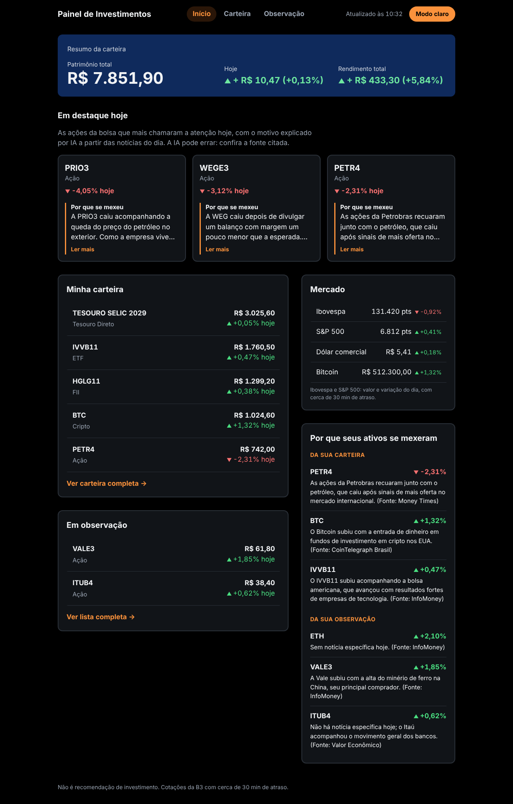
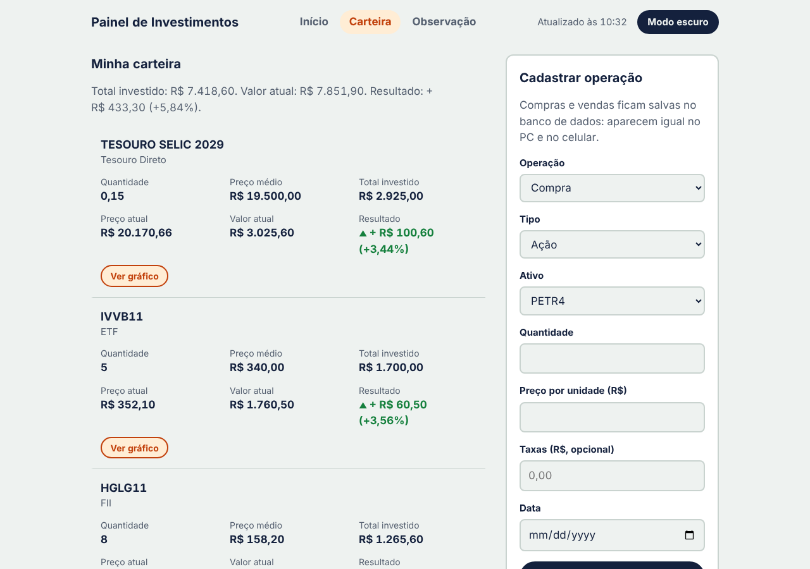
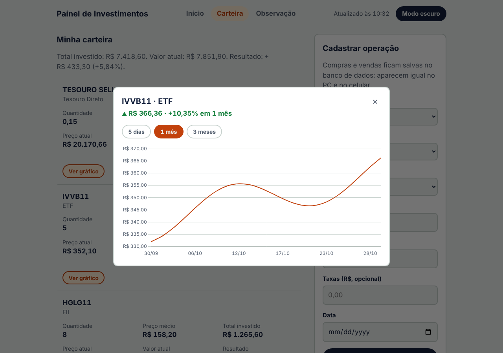
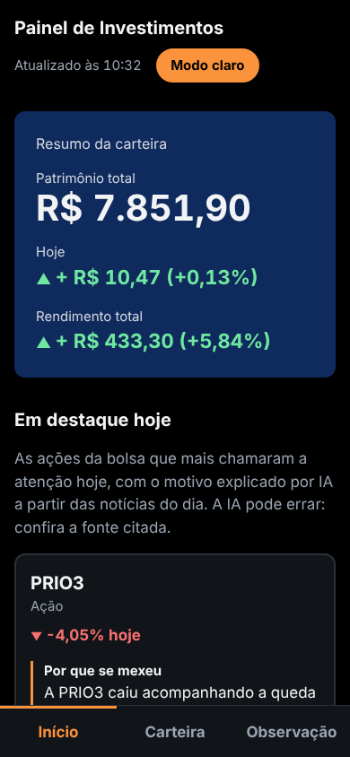

# Painel de Investimentos

Painel pessoal para acompanhar investimentos num lugar só, com visual simples e explicações para quem está começando.
Reúne ações, FIIs, ETFs e BDRs da B3, cripto, Tesouro Direto, dólar e índices, calcula o rendimento da carteira
e usa **IA para explicar, em linguagem simples, por que cada ativo subiu ou caiu no dia**, sempre citando a fonte da notícia.

> Projeto de estudo e de uso pessoal, feito para aprender desenvolvimento web completo: front-end, back-end, APIs,
> banco de dados, segurança e integração com IA.
> As imagens abaixo usam **dados fictícios**.



## Funcionalidades

- **Resumo da carteira:** patrimônio total, ganho ou perda do dia e rendimento total.
- **Em destaque hoje:** as ações da bolsa que mais se movimentaram, com o motivo explicado por IA.
- **Por que seus ativos se mexeram:** explicação da IA para os ativos da sua carteira e da sua lista de observação.
- **Carteira:** cadastro de compras e vendas (com taxas), edição e exclusão; posições com preço médio,
  valor atual e resultado em R$ e %.
- **Lista de observação:** ativos que você acompanha sem ter comprado, com opção de mostrar na página inicial.
- **Gráficos de histórico:** 5 dias, 1 mês e 3 meses.
- **Mercado:** Ibovespa, S&P 500, dólar comercial e Bitcoin.
- **Modo claro e escuro** e layout responsivo (PC e celular).

| Carteira | Gráfico | Celular |
|---|---|---|
|  |  |  |

## Como funciona

```
Navegador (HTML, CSS, JavaScript puro)
   │  só fala com as funções do próprio site, nunca guarda chaves
   ▼
Funções no servidor (Vercel Functions, pasta api/)
   ├── /api/cotacao      → brapi (ações, FIIs, ETFs, BDRs, índices)
   ├── /api/historico    → brapi (histórico para os gráficos)
   ├── /api/tesouro      → Tesouro Transparente (dados abertos do Tesouro Nacional)
   ├── /api/explicacao   → Google Notícias (RSS) + Gemini (IA)
   ├── /api/operacoes    → Supabase (compras e vendas)
   └── /api/observacao   → Supabase (lista de observação)
```

Dólar (AwesomeAPI) e cripto (CoinGecko) são APIs públicas sem chave, consultadas direto pelo navegador.

### A explicação da IA

1. A função busca as manchetes do dia sobre o ativo no Google Notícias.
2. Envia as manchetes ao Gemini com regras fixas: explicar em até 3 frases simples, usar **só os fatos das notícias**,
   citar a fonte, dizer quando não há notícia que explique o movimento e **nunca recomendar compra ou venda**.
3. A resposta fica em cache por 6 horas, para não gastar o limite gratuito a cada recarregamento.

A IA recebe apenas dados públicos (nome do ativo, se subiu ou caiu, manchetes). **Os valores da carteira nunca são enviados.**

## Segurança

- Chaves de API e do banco ficam só em **variáveis de ambiente** da Vercel, usadas pelas funções do servidor.
  Nenhuma chave aparece no código do navegador nem no repositório (`.env` está no `.gitignore`).
- O site inteiro é protegido pela **Vercel Authentication**: só o dono acessa.
- O banco (Supabase/PostgreSQL) tem **RLS ligado**: o acesso público é bloqueado e só a função do servidor,
  com a chave secreta, lê e grava.
- Todo dado recebido é **validado no servidor** antes de ir para o banco (tipos, limites, datas, saldo de venda),
  e o banco tem as próprias regras (`check`, `unique`) como segunda camada.
- Textos vindos de APIs e da IA entram na página com `textContent`, nunca como HTML (proteção contra XSS).

## Stack

| Parte | Tecnologia |
|---|---|
| Front-end | HTML, CSS e JavaScript puro, Chart.js (gráficos) |
| Back-end | Vercel Functions (Node.js) |
| Banco de dados | Supabase (PostgreSQL) |
| IA | Google Gemini (plano gratuito) |
| Dados | brapi, Tesouro Transparente, CoinGecko, AwesomeAPI, Google Notícias |
| Hospedagem | Vercel, com deploy automático a cada commit |

## Estrutura

```
index.html, carteira.html, observacao.html   páginas
css/style.css                                visual (cores do modo claro e escuro em variáveis)
js/                                          lógica de cada página e funções compartilhadas (comum.js)
api/                                         funções do servidor
db/schema.sql                                criação das tabelas do banco
docs/requisitos.md                           levantamento de requisitos e decisões do projeto
```

## Como rodar a sua própria cópia

1. Crie um projeto no [Supabase](https://supabase.com) e rode o `db/schema.sql` no SQL Editor.
2. Importe o repositório na [Vercel](https://vercel.com).
3. Cadastre as variáveis de ambiente: `BRAPI_TOKEN`, `SUPABASE_URL`, `SUPABASE_SECRET_KEY` e `GEMINI_API_KEY`.
4. Ative a Vercel Authentication (Settings → Deployment Protection) para que só você acesse seus dados.

## Aviso

Este painel mostra dados e explicações de fatos. **Não é recomendação de investimento.**
As cotações da B3 têm cerca de 30 minutos de atraso (plano gratuito da brapi), e a IA pode errar: confira sempre a fonte citada.
